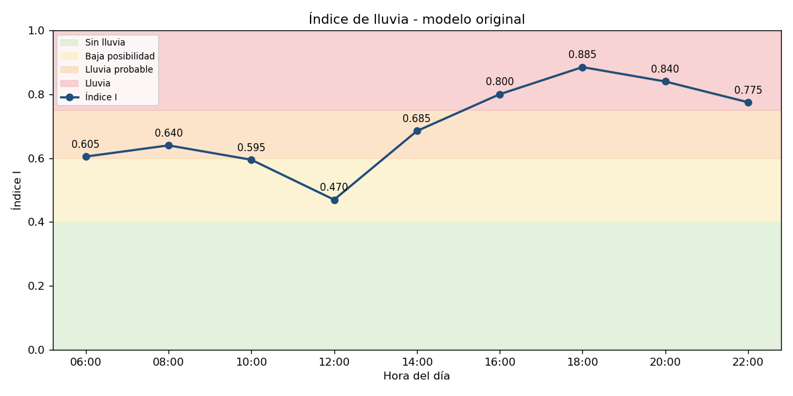
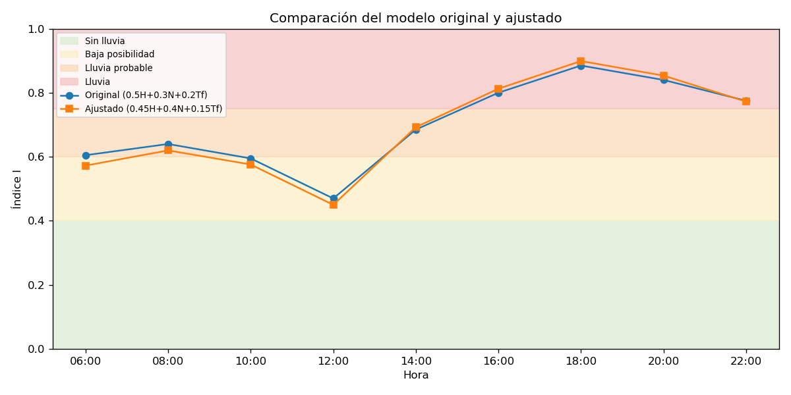
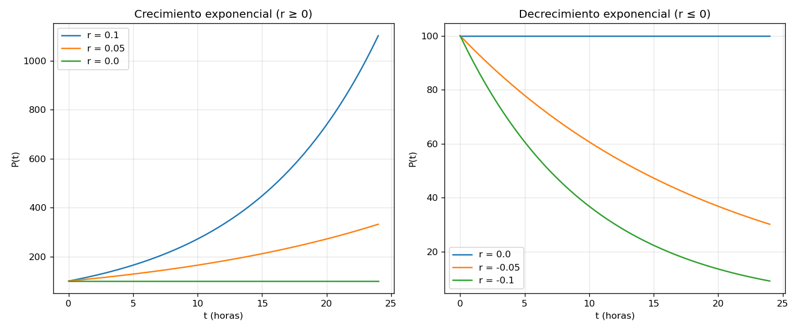

# Práctica 1: construcción y simulación de un modelo matemático

## 1. Descripción

Se simula la atmósfera durante el día (06:00 a 22:00) para saber en qué horas
existe posibilidad de lluvia con el índice:

```text
I = 0.5H + 0.3N + 0.2Tf
```

`H` es la humedad normalizada, `N` la nubosidad normalizada y `Tf` el factor de
temperatura. Después se ajusta el modelo y se compara. También se incluye el
modelo exponencial `P(t) = P0·e^(rt)` para analizar la influencia de `r`
(crecimiento y decrecimiento), que piden los resultados esperados y las
preguntas de control.

El proyecto se hizo en **Python** y en **Java**, los dos con arquitectura
**Modelo-Vista-Controlador**.

## 2. Tecnologías

- Python 3, NumPy y Matplotlib
- Java 17 o posterior (solo biblioteca estándar: Java2D e ImageIO para las gráficas)
- unittest para las pruebas de verificación

## 3. Instalación

Python, desde `Simulacion/python`:

```bash
python -m venv .venv
```

```bash
source .venv/bin/activate
```

```bash
python -m pip install -r requirements.txt
```

Java: solo se necesita un JDK 17+ instalado (`javac -version`).

## 4. Ejecución

Python, desde `Simulacion/python`:

```bash
python main.py
```

```bash
python -m unittest -v
```

Java, desde `Simulacion/java`:

```bash
javac -d out $(find src -name "*.java")
```

```bash
java -cp out Main
```

Ambos muestran las tablas en consola y guardan en `resultados/` las tablas CSV
y las gráficas.

## 5. Estructura

```text
Simulacion/
├── python/
│   ├── main.py                       # Punto de entrada
│   ├── model/                        # MODELO: datos y ecuaciones
│   │   ├── clima.py                  # Tf, índice I, reglas, simulación
│   │   └── exponencial.py            # P(t) = P0·e^(rt)
│   ├── view/                         # VISTA: presentación
│   │   ├── consola.py                # Tablas y CSV
│   │   └── graficas.py               # Gráficas PNG
│   ├── controller/
│   │   └── simulacion_controller.py  # CONTROLADOR: une modelo y vista
│   ├── tests/test_modelo.py          # Verificación
│   └── resultados/                   # Salidas generadas
└── java/src/
    ├── Main.java
    ├── model/       # Medicion, PesosModelo, ResultadoHora, ModeloClima, ModeloExponencial
    ├── view/        # VistaConsola, VistaGrafica
    └── controller/  # SimulacionController
```

## 6. Desarrollo según las etapas de la simulación

1. **Definición del problema:** determinar en qué horas del día puede llover.
2. **Formulación conceptual:**
   - Variables de entrada: humedad, nubosidad y temperatura (cambian cada hora).
   - Parámetros: los pesos 0.5, 0.3 y 0.2 y los umbrales de la tabla de reglas.
   - Variable de salida: el índice `I` y su estado.
3. **Datos:** la tabla de mediciones de la guía. El factor `Tf` baja 0.05 por
   grado, así que se usa la recta `Tf = 1 − 0.05(T − 10)` limitada a
   `[0.10, 1.00]`. Da los mismos valores de la tabla y permite calcular
   15 °C (0.75) y 17 °C (0.65).
4. **Construcción del modelo:** `model/clima.py` y `ModeloClima.java`.
5. **Verificación y validación:** las pruebas comprueban el ejemplo de la guía
   (90 %, 80 %, 18 °C → `I = 0.81`, Lluvia), la tabla de `Tf` y los límites de
   las reglas. Para validar se revisó si los resultados tienen sentido físico:
   el modelo original da *Lluvia probable* a las 06:00 con solo 40 % de nubes.
6. **Experimentación:** modelo original contra modelo ajustado y varios
   valores de `r`.
7. **Documentación:** este README, las tablas CSV y las gráficas.

## 7. Resultados

### Modelo original: I = 0.5H + 0.3N + 0.2Tf

| Hora  | Humedad | Nubosidad | Temp. | H    | N    | Tf   | Índice | Estado           |
|-------|---------|-----------|-------|------|------|------|--------|------------------|
| 06:00 | 65      | 40        | 14    | 0.65 | 0.40 | 0.80 | 0.6050 | Lluvia probable  |
| 08:00 | 70      | 50        | 16    | 0.70 | 0.50 | 0.70 | 0.6400 | Lluvia probable  |
| 10:00 | 68      | 45        | 18    | 0.68 | 0.45 | 0.60 | 0.5950 | Baja posibilidad |
| 12:00 | 60      | 30        | 22    | 0.60 | 0.30 | 0.40 | 0.4700 | Baja posibilidad |
| 14:00 | 75      | 70        | 20    | 0.75 | 0.70 | 0.50 | 0.6850 | Lluvia probable  |
| 16:00 | 85      | 85        | 18    | 0.85 | 0.85 | 0.60 | 0.8000 | Lluvia           |
| 18:00 | 92      | 95        | 16    | 0.92 | 0.95 | 0.70 | 0.8850 | Lluvia           |
| 20:00 | 88      | 90        | 17    | 0.88 | 0.90 | 0.65 | 0.8400 | Lluvia           |
| 22:00 | 80      | 75        | 15    | 0.80 | 0.75 | 0.75 | 0.7750 | Lluvia           |

### Ajuste del modelo: I = 0.45H + 0.40N + 0.15Tf

**Por qué:** en el modelo original la temperatura pesa demasiado y una mañana
fría con pocas nubes (06:00) sale como *Lluvia probable*. Sin nubes no hay
lluvia, así que se sube el peso de la nubosidad (0.30 → 0.40) y se baja el de
la temperatura (0.20 → 0.15) y el de la humedad (0.50 → 0.45). Los pesos siguen
sumando 1, por lo que `I` sigue entre 0 y 1.

| Hora  | Humedad | Nubosidad | Temp. | H    | N    | Tf   | Índice | Estado           |
|-------|---------|-----------|-------|------|------|------|--------|------------------|
| 06:00 | 65      | 40        | 14    | 0.65 | 0.40 | 0.80 | 0.5725 | Baja posibilidad |
| 08:00 | 70      | 50        | 16    | 0.70 | 0.50 | 0.70 | 0.6200 | Lluvia probable  |
| 10:00 | 68      | 45        | 18    | 0.68 | 0.45 | 0.60 | 0.5760 | Baja posibilidad |
| 12:00 | 60      | 30        | 22    | 0.60 | 0.30 | 0.40 | 0.4500 | Baja posibilidad |
| 14:00 | 75      | 70        | 20    | 0.75 | 0.70 | 0.50 | 0.6925 | Lluvia probable  |
| 16:00 | 85      | 85        | 18    | 0.85 | 0.85 | 0.60 | 0.8125 | Lluvia           |
| 18:00 | 92      | 95        | 16    | 0.92 | 0.95 | 0.70 | 0.8990 | Lluvia           |
| 20:00 | 88      | 90        | 17    | 0.88 | 0.90 | 0.65 | 0.8535 | Lluvia           |
| 22:00 | 80      | 75        | 15    | 0.80 | 0.75 | 0.75 | 0.7725 | Lluvia           |

**Conclusión:** en los dos modelos la lluvia se concentra de 16:00 a 22:00
(máximo a las 18:00, `I ≈ 0.89`). El ajuste corrige la hora 06:00, que pasa a
*Baja posibilidad*; las horas con nubosidad alta no cambian de estado.

### Gráficas

| Archivo | Contenido |
|---------|-----------|
| `indice_original.png`, `indice_ajustado.png` | Índice por hora sobre las franjas de la tabla de reglas |
| `comparacion.png` | Modelo original contra ajustado |
| `variables.png` | H, N y Tf normalizados (solo en Python) |
| `exponencial.png` | Crecimiento (r > 0) y decrecimiento (r < 0) |





### Influencia de r (P0 = 100, t = 24 h)

| r     | P(24)   | Duplicación / vida media | Comportamiento |
|-------|---------|--------------------------|----------------|
| 0.10  | 1102.32 | 6.93 h                   | Crecimiento    |
| 0.05  | 332.01  | 13.86 h                  | Crecimiento    |
| 0.00  | 100.00  | —                        | Constante      |
| −0.05 | 30.12   | 13.86 h                  | Decrecimiento  |
| −0.10 | 9.07    | 6.93 h                   | Decrecimiento  |

**Interpretación matemática:**

- Índice de lluvia: es una combinación lineal, `∂I/∂H = 0.5`, `∂I/∂N = 0.3` y
  `∂I/∂Tf = 0.2`; cada peso dice cuánto sube `I` cuando esa variable sube una
  unidad. Como `Tf` baja con la temperatura, el calor reduce el índice.
- Exponencial: `dP/dt = rP`, la variación es proporcional al valor actual. El
  signo de `r` decide si crece o decrece, y `|r|` la rapidez. Duplicar `r`
  divide a la mitad el tiempo de duplicación (`ln2/|r|`).

## 8. Preguntas de control

1. **¿Qué es un modelo matemático?** Una representación simplificada de un
   sistema real mediante variables, parámetros y ecuaciones que permite
   describirlo y predecir su comportamiento.
2. **¿Diferencia entre variable y parámetro?** La variable cambia durante la
   simulación (humedad, tiempo, P(t)); el parámetro es fijo en una ejecución y
   define el modelo (pesos, P0, r).
3. **¿Qué representa P₀?** El valor inicial de la población o magnitud, en
   `t = 0`.
4. **¿Qué ocurre cuando r < 0?** Hay decrecimiento exponencial: P(t) disminuye
   y tiende a 0 sin llegar a ser negativo.
5. **¿Limitaciones del modelo exponencial?** Supone recursos ilimitados y `r`
   constante, por eso con `r > 0` crece sin límite; no considera capacidad de
   carga, competencia ni factores externos. Solo sirve en periodos cortos (el
   modelo logístico corrige esto).

## 9. Autor

Anthony José Yaguana Pérez, Simulación, ciclo 5, Computación.
