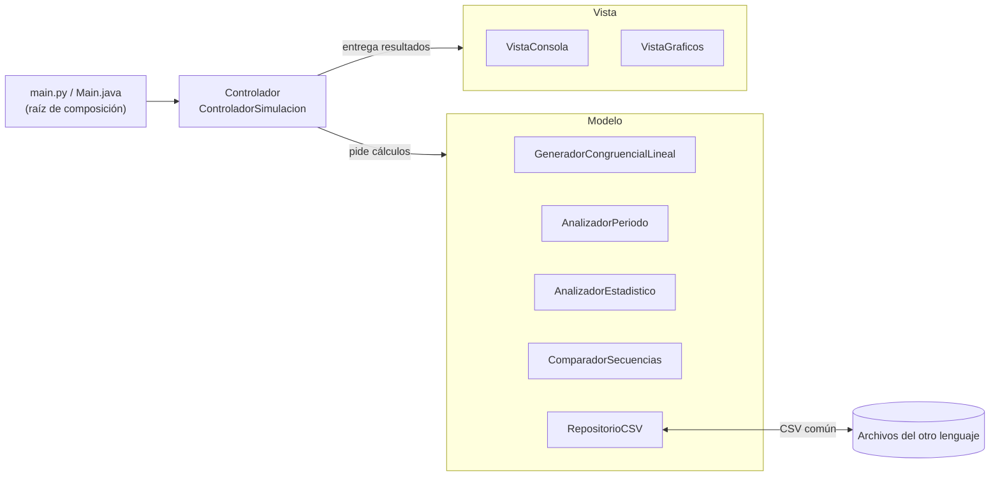

# Generador Congruencial Lineal (LCG) en Python y Java

Implementación del **Generador Congruencial Lineal** en dos lenguajes, con arquitectura **Modelo-Vista-Controlador (MVC)** y principios **SOLID**:

```
X(n+1) = (a · X(n) + c) mod m          U(n) = X(n) / m
a = 1664525    c = 1013904223    m = 2^32    X(0) = 12345
```

Ambas versiones generan 10 000 valores con los mismos parámetros y producen **exactamente la misma secuencia**: los archivos CSV de salida de Python y de Java son idénticos byte a byte.

> El informe de la práctica (etapas de la simulación, tabla comparativa Python vs Java, análisis y conclusiones) está en **[INFORME.md](INFORME.md)**.

---

## 1. Descripción

El proyecto sigue el procedimiento de la práctica:

| Paso | Qué hace el programa |
|:---:|---|
| 1 | Usa a = 1664525, c = 1013904223, m = 2³² y semilla 12345 (modificables por línea de comandos). |
| 2 | Genera 10 000 valores en **Python**. |
| 3 | Genera los mismos 10 000 valores con el mismo algoritmo en **Java**. |
| 4 | Compara las primeras 20 observaciones en una tabla Python vs Java y valida los 10 000 valores. |
| 5 | Grafica la secuencia: U(n) frente a n, histograma de frecuencias y dispersión U(n) vs U(n+1). |
| 6 | Analiza el período: teorema de Hull-Dobell, búsqueda de repeticiones en la muestra, medición exhaustiva del ciclo con el algoritmo de Brent y escenarios con parámetros inadecuados. |
| 7 | Cambia la semilla (12345 → 54321) y genera una nueva secuencia. |
| 8 | Compara los resultados: estadísticos de ambas semillas y Python vs Java con la nueva semilla. |

Cada implementación guarda su secuencia en un CSV con un formato común; al ejecutarse, cada programa busca el CSV del otro lenguaje y arma la tabla comparativa automáticamente.

## 2. Tecnologías utilizadas

| Tecnología | Versión | Uso |
|---|---|---|
| Python | 3.10 o superior (probado con 3.13.5) | Primera implementación |
| matplotlib | 3.6 o superior (probado con 3.10.1) | Gráficas de la versión Python |
| unittest | biblioteca estándar de Python | Pruebas de la versión Python |
| Java (JDK) | 17 o superior (probado con OpenJDK 17.0.2) | Segunda implementación |
| Java2D + ImageIO | incluidos en el JDK | Gráficas PNG de la versión Java |
| CSV | — | Intercambio de datos entre ambas implementaciones |

La versión Java no usa librerías externas; la versión Python solo necesita matplotlib para las gráficas.

## 3. Instalación de dependencias y configuración del entorno

### Python

1. Verificar la versión (debe ser 3.10 o superior):

   ```bash
   python3 --version
   ```

2. Instalar matplotlib. Elija una opción:

   - **Debian / Ubuntu** (instalación del sistema, la más simple):

     ```bash
     sudo apt install python3-matplotlib
     ```

   - **Entorno virtual con pip** (Windows, macOS o Linux). En Debian/Ubuntu primero instale `python3-venv` con apt.

     ```bash
     cd Python
     python3 -m venv .venv
     source .venv/bin/activate        # En Windows: .venv\Scripts\activate
     pip install -r requirements.txt
     ```

Las gráficas se guardan como PNG sin abrir ventanas, así que el programa también funciona en terminales sin entorno gráfico. Si matplotlib no está instalado, se puede ejecutar con `--sin-graficas`.

### Java

1. Instalar un JDK 17 o superior (se necesita `javac`, no solo `java`):

   - **Debian / Ubuntu:** `sudo apt install default-jdk`
   - **Windows / macOS:** descargar Eclipse Temurin desde <https://adoptium.net>.

2. Verificar la instalación:

   ```bash
   javac -version
   java -version
   ```

No hay que configurar nada más: el proyecto se compila directamente con `javac`.

## 4. Ejecución

Cada programa compara sus resultados con los del otro lenguaje si ya existen. Por eso se recomienda este orden: **Java → Python → Java** (la segunda ejecución de Java también arma la comparación desde su lado).

### Versión Java

Linux / macOS:

```bash
cd Java
javac -encoding UTF-8 -d out $(find src -name "*.java")
java -cp out lcg.Main
```

Windows (PowerShell):

```powershell
cd Java
javac -encoding UTF-8 -d out (Get-ChildItem -Recurse -Filter *.java -Path src).FullName
java -cp out lcg.Main
```

El programa debe ejecutarse **dentro de la carpeta `Java`**, porque usa las rutas relativas `resultados/` y `../Python/resultados/`. Si los acentos se ven mal en la consola de Windows, ejecute antes `chcp 65001`.

### Versión Python

```bash
cd Python
python3 main.py
```

En Windows use `python main.py`. Las rutas se calculan desde la ubicación de `main.py`, así que también funciona desde otra carpeta: `python3 Python/main.py`.

### Pruebas automáticas

Python (33 pruebas):

```bash
cd Python
python3 -m unittest -v
```

Java (18 pruebas, después de compilar `src`):

```bash
cd Java
javac -encoding UTF-8 -cp out -d out $(find test -name "*.java")
java -cp out lcg.PruebasLCG
```

### Opciones de línea de comandos

Las dos versiones aceptan las mismas opciones (`--help` las muestra todas):

| Opción | Valor por defecto | Descripción |
|---|---|---|
| `--a N` | 1664525 | Multiplicador |
| `--c N` | 1013904223 | Incremento |
| `--m N` | 4294967296 (2³²) | Módulo |
| `--semilla N` | 12345 | Semilla X(0) |
| `--semilla-alternativa N` | 54321 | Semilla del paso 7 |
| `--n N` | 10000 | Cantidad de valores a generar |
| `--filas N` | 20 | Filas que se muestran en las tablas |
| `--periodo-completo` | desactivado | Recorre el ciclo completo con el algoritmo de Brent (Java: unos 70 s; Python: unos 33 min) |
| `--resultados RUTA` | `resultados` | Carpeta de salida |
| `--comparar-con RUTA` | carpeta `resultados` de la otra versión | Dónde buscar el CSV del otro lenguaje |
| `--sin-graficas` | desactivado | No genera imágenes |

Ejemplos:

```bash
java -cp out lcg.Main --periodo-completo
```

```bash
python3 main.py --semilla 2024 --semilla-alternativa 777
```

```bash
python3 main.py --a 1664524
```

El último ejemplo usa un multiplicador inadecuado: el programa muestra que Hull-Dobell no se cumple y que la secuencia se vuelve constante a partir de X(16).

### Verificación independiente de los archivos

Desde la carpeta raíz, estas órdenes confirman que ambas implementaciones generaron archivos idénticos (no muestran diferencias y los dos hashes coinciden):

```bash
cmp Python/resultados/secuencia_python_semilla_12345.csv Java/resultados/secuencia_java_semilla_12345.csv
```

```bash
sha256sum Python/resultados/secuencia_python_semilla_*.csv Java/resultados/secuencia_java_semilla_*.csv
```

## 5. Estructura del proyecto

```
APE5/
├── README.md                          Este documento
├── INFORME.md                         Informe: etapas de la simulación, tablas y conclusiones
├── .gitignore
├── Python/
│   ├── main.py                        Punto de entrada: lee opciones y conecta las capas
│   ├── requirements.txt               Dependencia externa (matplotlib)
│   ├── lcg/
│   │   ├── modelo/                    MODELO: lógica del dominio
│   │   │   ├── parametros.py          ParametrosLCG (a, c, m, semilla validados)
│   │   │   ├── observacion.py         Observacion (n, X(n), U(n))
│   │   │   ├── generador.py           GeneradorPseudoaleatorio (abstracto) y GeneradorCongruencialLineal
│   │   │   ├── analizador_periodo.py  Hull-Dobell, repeticiones y algoritmo de Brent
│   │   │   ├── analizador_estadistico.py  Media, varianza, chi-cuadrado y autocorrelación
│   │   │   ├── comparador.py          Comparación posición por posición
│   │   │   ├── repositorio.py         Lectura y escritura de CSV
│   │   │   └── resultados.py          Estructuras que agrupan resultados
│   │   ├── vista/                     VISTA: presentación
│   │   │   ├── contratos.py           Interfaces VistaResultados y VistaGraficos
│   │   │   ├── vista_consola.py       Tablas de texto
│   │   │   └── vista_graficos.py      Gráficas con matplotlib
│   │   └── controlador/               CONTROLADOR: orquesta los 8 pasos
│   │       ├── configuracion.py       Valores de la práctica y escenarios
│   │       └── controlador_simulacion.py
│   ├── tests/                         Pruebas unitarias y de integración
│   └── resultados/                    CSV y PNG generados
└── Java/
    ├── src/lcg/
    │   ├── Main.java                  Punto de entrada: lee opciones y conecta las capas
    │   ├── modelo/                    MODELO (mismas clases que en Python)
    │   │   ├── ParametrosLCG.java, Observacion.java
    │   │   ├── GeneradorPseudoaleatorio.java, GeneradorCongruencialLineal.java
    │   │   ├── AnalizadorPeriodo.java, ResultadoHullDobell.java, ResultadoCiclo.java
    │   │   ├── AnalizadorEstadistico.java, ResumenEstadistico.java
    │   │   ├── ComparadorSecuencias.java, ResultadoComparacion.java, FilaComparacion.java
    │   │   ├── RepositorioSecuencias.java, RepositorioCSV.java
    │   │   └── AnalisisSecuencia.java, EscenarioPeriodo.java, AnalisisEscenario.java
    │   ├── vista/                     VISTA
    │   │   ├── VistaResultados.java, VistaGraficos.java   Interfaces
    │   │   ├── VistaConsola.java      Tablas de texto (mismo formato que Python)
    │   │   └── VistaGraficosJava2D.java  Gráficas PNG con Java2D
    │   ├── controlador/               CONTROLADOR
    │   │   ├── ConfiguracionSimulacion.java
    │   │   └── ControladorSimulacion.java
    │   └── util/FormatoDecimal.java   Redondeo decimal idéntico al de Python
    ├── test/lcg/PruebasLCG.java       Pruebas sin dependencias externas
    ├── out/                           Clases compiladas (se genera al compilar)
    └── resultados/                    CSV y PNG generados
```

Archivos que genera cada ejecución:

| Archivo | Python | Java | Contenido |
|---|:---:|:---:|---|
| `secuencia_<lenguaje>_semilla_<s>.csv` | ✓ | ✓ | n, X(n), U(n) de los 10 000 valores (semillas 12345 y 54321) |
| `comparacion_<lenguaje>_<otro>_semilla_<s>.csv` | ✓ | ✓ | Tabla completa de la comparación entre lenguajes |
| `secuencia_semilla_12345.png` | ✓ | ✓ | U(n) frente a n |
| `histograma_semilla_12345.png` | ✓ | ✓ | Frecuencias por intervalo y prueba chi-cuadrado |
| `dispersion_semilla_12345.png` | ✓ | ✓ | U(n+1) frente a U(n) |
| `comparacion_python_java.png` | ✓ | | Python y Java superpuestos y su diferencia |
| `escenarios_periodo.png` | ✓ | | Ciclos con parámetros adecuados e inadecuados |
| `comparacion_semillas.png` | ✓ | | Semilla 12345 frente a 54321 |

## 6. Información adicional

### Arquitectura MVC



- **Modelo:** genera la secuencia, calcula período y estadísticos, compara y guarda datos. No imprime ni dibuja nada.
- **Vista:** muestra tablas y gráficas a partir de los objetos del modelo. No hace cálculos del dominio.
- **Controlador:** ejecuta los 8 pasos en orden; pide los datos al modelo y se los pasa a la vista.

### Principios SOLID aplicados

| Principio | Dónde se aplica |
|---|---|
| **S** Responsabilidad única | Cada clase tiene una sola tarea: `ParametrosLCG` valida, `GeneradorCongruencialLineal` genera, `AnalizadorPeriodo` analiza el ciclo, `RepositorioCSV` persiste, `VistaConsola` presenta. |
| **O** Abierto/cerrado | Se puede agregar otro generador (por ejemplo, multiplicativo) implementando `GeneradorPseudoaleatorio`, sin modificar analizadores, vistas ni controlador. |
| **L** Sustitución de Liskov | Cualquier implementación de `GeneradorPseudoaleatorio`, `RepositorioSecuencias` o de las vistas puede reemplazar a la actual sin cambiar el comportamiento del controlador. |
| **I** Segregación de interfaces | La vista se divide en `VistaResultados` (texto) y `VistaGraficos` (imágenes); el analizador de período solo necesita la función de transición, no todo el generador. |
| **D** Inversión de dependencias | El controlador recibe por constructor abstracciones (fábrica de generadores, repositorio, vistas); solo `main.py` y `Main.java` crean las clases concretas. |

### Funcionalidades

- Generación reproducible de la secuencia con cualquier conjunto de parámetros válido.
- Tabla comparativa Python vs Java de las primeras 20 observaciones y validación de los 10 000 valores, para ambas semillas.
- Teorema de Hull-Dobell verificado condición por condición.
- Medición del período con el algoritmo de Brent (memoria constante, detecta también una "cola" previa al ciclo).
- Escenarios con parámetros inadecuados que muestran cómo se acorta el período.
- Estadísticos de uniformidad e independencia: media, varianza, chi-cuadrado con 10 intervalos y autocorrelación de retardo 1.
- Salida de consola idéntica en ambos lenguajes (mismas tablas y decimales).
- 51 pruebas automáticas (33 en Python y 18 en Java), incluida la secuencia publicada en *Numerical Recipes* como referencia externa.

### Detalles para que ambos lenguajes coincidan exactamente

| Diferencia entre lenguajes | Solución aplicada |
|---|---|
| Python tiene enteros sin límite; `long` de Java tiene 64 bits | `ParametrosLCG` exige en ambos lenguajes que a·(m − 1) + c quepa en 64 bits. |
| En Java, `x / m` entre enteros da 0 | Java convierte explícitamente: `(double) x / m`. |
| `String.format` de Java redondea distinto que Python en los empates | `FormatoDecimal` usa `BigDecimal` con redondeo al par (`HALF_EVEN`), la misma regla de Python. |
| `sum()` de Python usa suma compensada desde la versión 3.12 | Las sumas usan bucles explícitos en el mismo orden en los dos lenguajes. |
| Saltos de línea distintos en Windows | Los CSV se escriben siempre con `\n`. |

### Resultados principales

| Resultado | Valor |
|---|---|
| Coincidencias Python vs Java (semilla 12345) | 10 000 de 10 000 |
| Coincidencias Python vs Java (semilla 54321) | 10 000 de 10 000 |
| SHA-256 de los CSV de la semilla 12345 (ambos lenguajes) | `f7429810…e81c733c4` |
| Período teórico (Hull-Dobell) | 2³² = 4 294 967 296 |
| Período medido exhaustivamente en Java (Brent) | 4 294 967 296, en 68 s |
| Chi-cuadrado (10 intervalos), semilla 12345 / 54321 | 14,16 / 7,23 (crítico 16,919: se acepta la uniformidad) |

### Capturas

| Secuencia U(n) (Python) | Histograma (Python) |
|---|---|
|  |  |

| Python vs Java | Escenarios del período |
|---|---|
|  |  |

| Cambio de semilla | Secuencia U(n) (Java2D) |
|---|---|
|  |  |

Extracto de la salida de consola (igual en ambos lenguajes):

```
  Paso 4. Primeras 20 observaciones: Python vs Java
  +----+-------------+------------+--------------+--------------+------------+
  | n  | X(n) Python | X(n) Java  | U(n) Python  |  U(n) Java   | ¿Coincide? |
  +----+-------------+------------+--------------+--------------+------------+
  |  1 |    87628868 |   87628868 | 0.0204026857 | 0.0204026857 | Sí         |
  |  2 |    71072467 |   71072467 | 0.0165478482 | 0.0165478482 | Sí         |
  |  3 |  2332836374 | 2332836374 | 0.5431557945 | 0.5431557945 | Sí         |
  ...
  Python vs Java: 10000 de 10000 posiciones coinciden (longitudes 10000 y 10000).
  Diferencia máxima en U(n): 0.0000000000
  Veredicto: las secuencias son IDÉNTICAS.
```

### Autor

**Anthony Yaguana** — Práctica APE5: Generador Congruencial Lineal.
