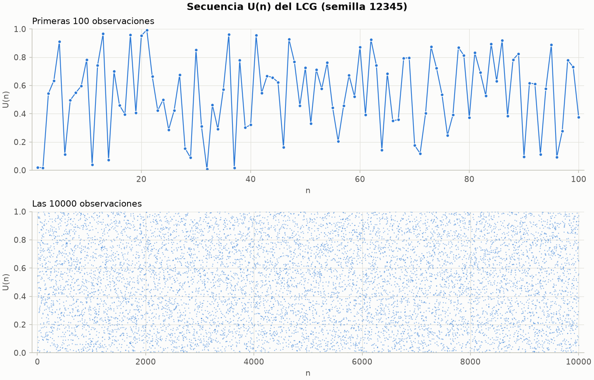
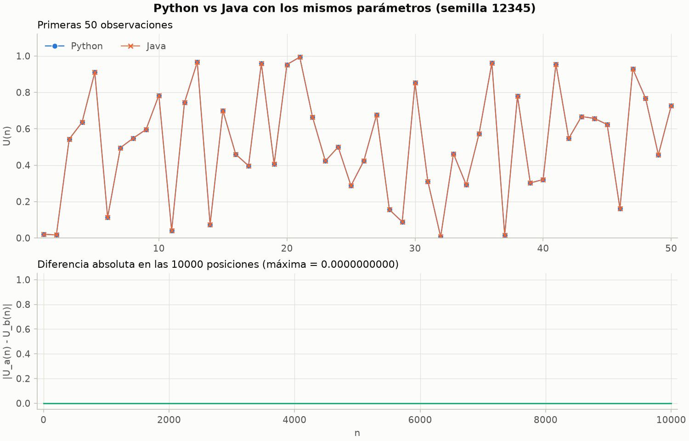
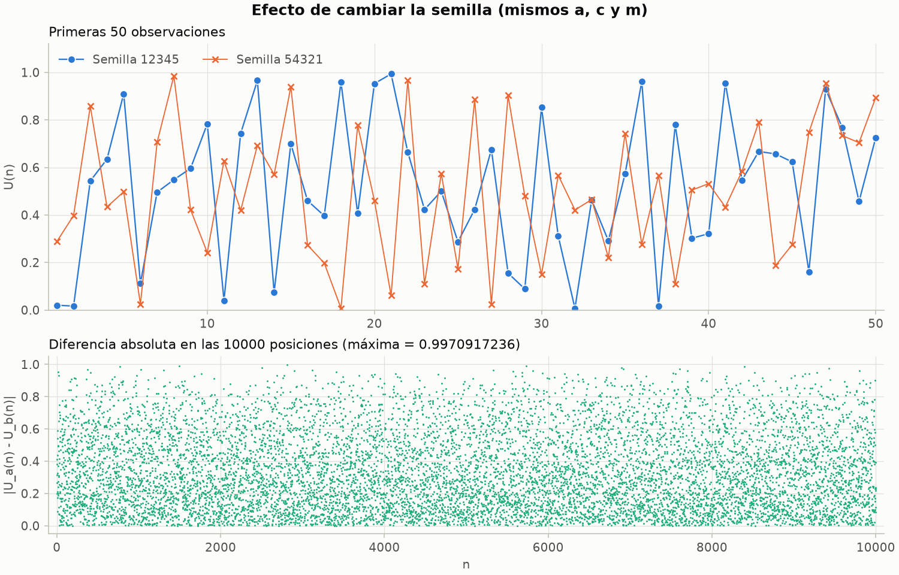

# Generador Congruencial Lineal (LCG) en Python y Java

Implementación del **Generador Congruencial Lineal** (LCG):

```
X(n+1) = (a · X(n) + c) mod m          U(n) = X(n) / m
a = 1664525    c = 1013904223    m = 2^32    X(0) = 12345
```

Ambas versiones generan 10 000 valores con los mismos parámetros y producen **exactamente la misma secuencia**: los archivos CSV de salida de Python y de Java son idénticos.


---

## 1. Descripción

El proyecto sigue el procedimiento del Informe:

| Paso | Qué hace el programa |
|:---:|---|
| 1 | Usa a = 1664525, c = 1013904223, m = 2³² y semilla 12345 (modificables por línea de comandos). |
| 2 | Genera 10 000 valores en **Python**. |
| 3 | Genera los mismos 10 000 valores con el mismo algoritmo en **Java**. |
| 4 | Compara las primeras 20 observaciones en una tabla Python vs Java y valida los 10 000 valores. |
| 5 | Grafica la secuencia: U(n) frente a n, histograma de frecuencias y dispersión U(n) vs U(n+1). |
| 6 | Analiza el período: teorema de Hull-Dobell, búsqueda de repeticiones en la muestra, medición exhaustiva del ciclo con el algoritmo de Brent y escenarios con parámetros inadecuados. |
| 7 | Cambia la semilla (12345 → 54321) y genera una nueva secuencia. |
| 8 | Compara los resultados: estadísticos de ambas semillas y Python vs Java con la nueva semilla. |

Cada implementación guarda su secuencia en un CSV con un formato común; al ejecutarse, cada programa busca el CSV del otro lenguaje y arma la tabla comparativa automáticamente.

## 2. Tecnologías utilizadas

| Tecnología | Versión | Uso |
|---|---|---|
| Python | 3.10 o superior (probado con 3.13.5) | Primera implementación |
| matplotlib | 3.6 o superior (probado con 3.10.1) | Gráficas de la versión Python |
| unittest | biblioteca estándar de Python | Pruebas de la versión Python |
| Java (JDK) | 17 o superior (probado con OpenJDK 17.0.2) | Segunda implementación |
| Java2D + ImageIO | incluidos en el JDK | Gráficas PNG de la versión Java |


## 3. Instalación de dependencias y configuración del entorno

### Python

1. Verificar la versión (debe ser 3.10 o superior):

   ```bash
   python3 --version
   ```

2. Instalar matplotlib. Elija una opción:

   - **Debian / Ubuntu**:

     ```bash
     sudo apt install python3-matplotlib
     ```

   - **Entorno virtual con pip** 

     ```bash
     cd Python
     python3 -m venv .venv
     source .venv/bin/activate        
     pip install -r requirements.txt
     ```


### Java

1. Instalar un JDK 17 o superior (se necesita `javac`, no solo `java`):

   - **Debian / Ubuntu:** `sudo apt install default-jdk`

2. Verificar la instalación:

   ```bash
   javac -version
   java -version
   ```

No hay que configurar nada más: el proyecto se compila directamente con `javac`.

## 4. Ejecución

Cada programa compara sus resultados con los del otro lenguaje si ya existen. Por eso se recomienda este orden: **Java → Python → Java** (la segunda ejecución de Java también arma la comparación desde su lado).

### Versión Java

```bash
cd Java
javac -encoding UTF-8 -d out $(find src -name "*.java")
java -cp out lcg.Main
```

El programa debe ejecutarse **dentro de la carpeta `Java`**

### Versión Python

```bash
cd Python
python3 main.py
```

## 5. Estructura del proyecto

```
APE5/
├── README.md                          Este documento
├── Python/
│   ├── main.py                        Punto de entrada: lee opciones y conecta las capas
│   ├── requirements.txt               Dependencia externa (matplotlib)
│   ├── lcg/
│   │   ├── modelo/                    MODELO: lógica del dominio
│   │   │   ├── parametros.py          ParametrosLCG (a, c, m, semilla validados)
│   │   │   ├── observacion.py         Observacion (n, X(n), U(n))
│   │   │   ├── generador.py           GeneradorPseudoaleatorio (abstracto) y GeneradorCongruencialLineal
│   │   │   ├── analizador_periodo.py  Hull-Dobell, repeticiones y algoritmo de Brent
│   │   │   ├── analizador_estadistico.py  Media, varianza, chi-cuadrado y autocorrelación
│   │   │   ├── comparador.py          Comparación posición por posición
│   │   │   ├── repositorio.py         Lectura y escritura de CSV
│   │   │   └── resultados.py          Estructuras que agrupan resultados
│   │   ├── vista/                     VISTA: presentación
│   │   │   ├── contratos.py           Interfaces VistaResultados y VistaGraficos
│   │   │   ├── vista_consola.py       Tablas de texto
│   │   │   └── vista_graficos.py      Gráficas con matplotlib
│   │   └── controlador/               CONTROLADOR: orquesta los 8 pasos
│   │       ├── configuracion.py       Valores de la práctica y escenarios
│   │       └── controlador_simulacion.py
│   ├── tests/                         Pruebas unitarias y de integración
│   └── resultados/                    CSV y PNG generados
└── Java/
    ├── src/lcg/
    │   ├── Main.java                  Punto de entrada: lee opciones y conecta las capas
    │   ├── modelo/                    MODELO (mismas clases que en Python)
    │   │   ├── ParametrosLCG.java, Observacion.java
    │   │   ├── GeneradorPseudoaleatorio.java, GeneradorCongruencialLineal.java
    │   │   ├── AnalizadorPeriodo.java, ResultadoHullDobell.java, ResultadoCiclo.java
    │   │   ├── AnalizadorEstadistico.java, ResumenEstadistico.java
    │   │   ├── ComparadorSecuencias.java, ResultadoComparacion.java, FilaComparacion.java
    │   │   ├── RepositorioSecuencias.java, RepositorioCSV.java
    │   │   └── AnalisisSecuencia.java, EscenarioPeriodo.java, AnalisisEscenario.java
    │   ├── vista/                     VISTA
    │   │   ├── VistaResultados.java, VistaGraficos.java   Interfaces
    │   │   ├── VistaConsola.java      Tablas de texto (mismo formato que Python)
    │   │   └── VistaGraficosJava2D.java  Gráficas PNG con Java2D
    │   ├── controlador/               CONTROLADOR
    │   │   ├── ConfiguracionSimulacion.java
    │   │   └── ControladorSimulacion.java
    │   └── util/FormatoDecimal.java   Redondeo decimal idéntico al de Python
    ├── test/lcg/PruebasLCG.java       Pruebas sin dependencias externas
    ├── out/                           Clases compiladas (se genera al compilar)
    └── resultados/                    CSV y PNG generados
```

## 6. Información adicional

### Arquitectura MVC

- **Modelo:** genera la secuencia, calcula período y estadísticos, compara y guarda datos. No imprime ni dibuja nada.
- **Vista:** muestra tablas y gráficas a partir de los objetos del modelo. No hace cálculos del dominio.
- **Controlador:** ejecuta los 8 pasos en orden; pide los datos al modelo y se los pasa a la vista.


### Resultados principales

| Resultado | Valor |
|---|---|
| Coincidencias Python vs Java (semilla 12345) | 10 000 de 10 000 |
| Coincidencias Python vs Java (semilla 54321) | 10 000 de 10 000 |
| Período teórico (Hull-Dobell) | 2³² = 4 294 967 296 |

### Capturas

| Secuencia U(n) (Python) | 
|---|
|  | 

| Python vs Java |  
|---|
|  | 

| Cambio de semilla | 
|---|
|  |
### Autor

**Anthony Yaguana** 
