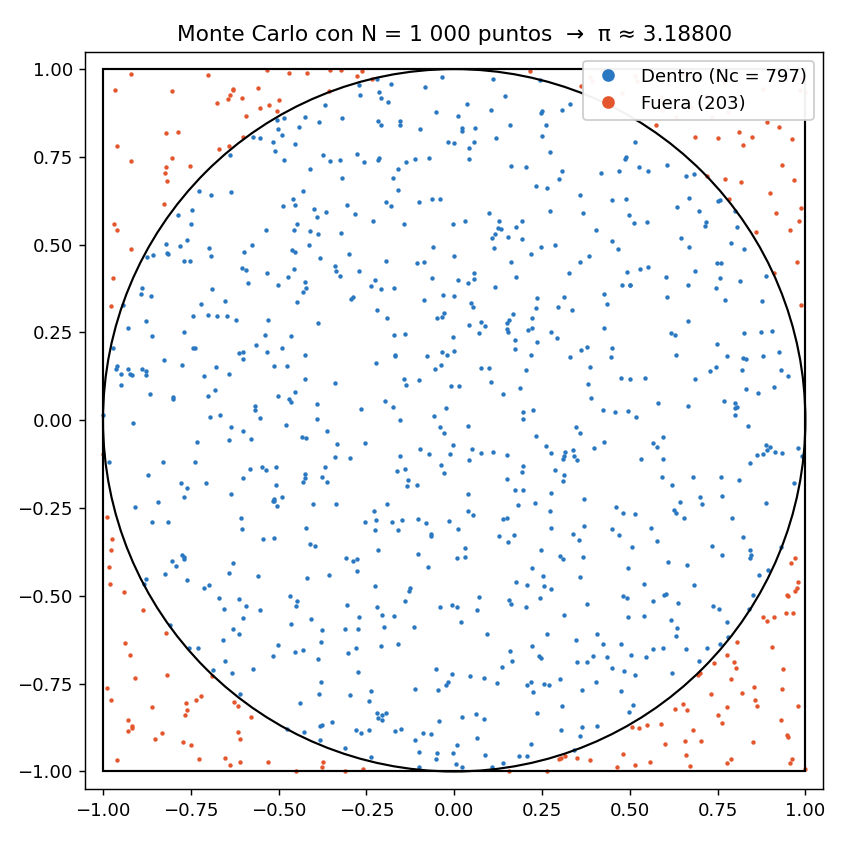
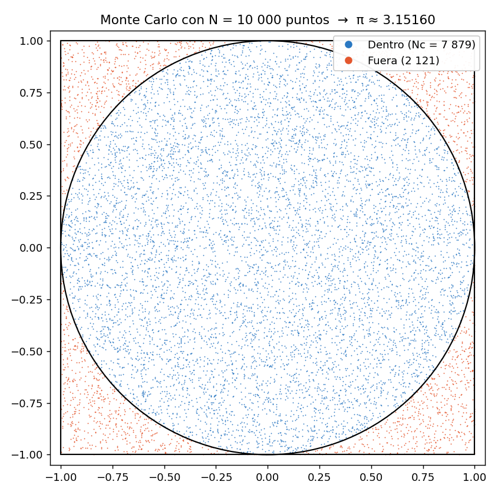
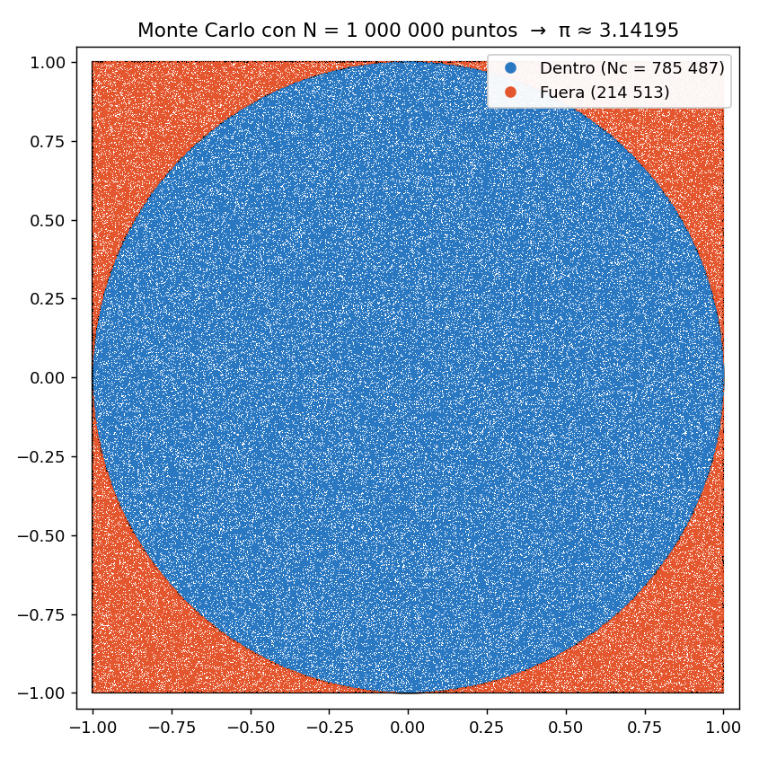
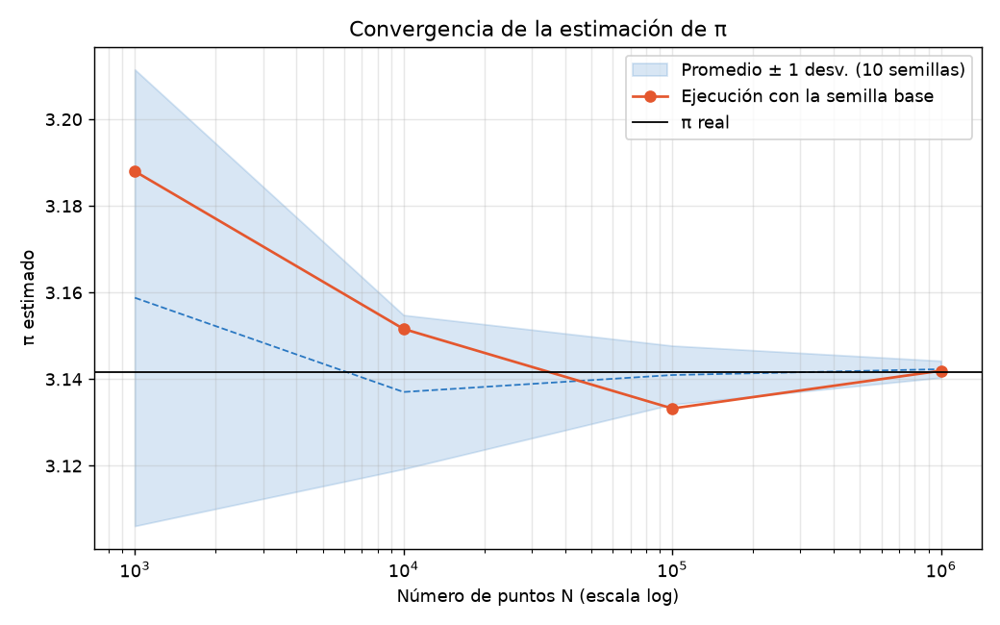
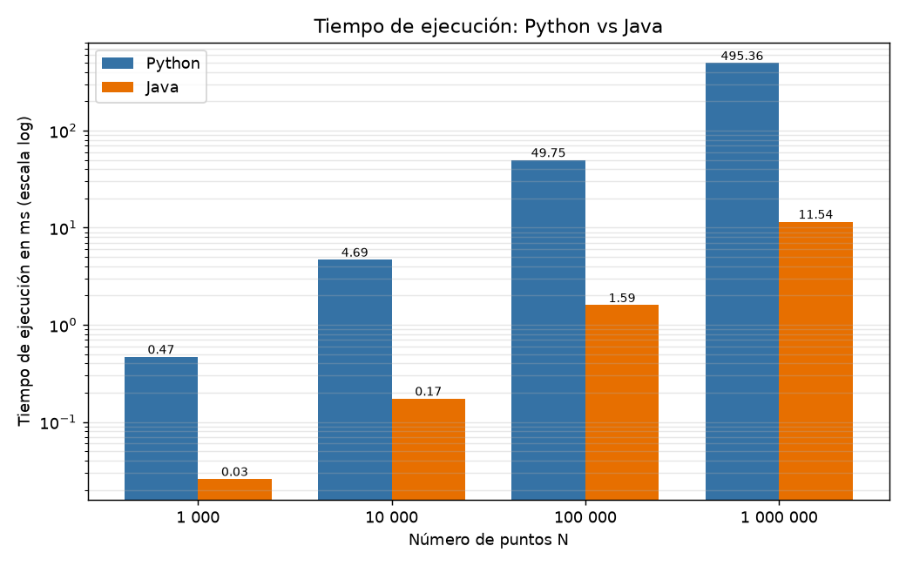

# Estimación de π mediante el método de Monte Carlo

Práctica 07 de Simulación (Unidad 2). Se aplica el **método de Monte Carlo** para aproximar π lanzando
puntos pseudoaleatorios sobre un cuadrado y contando cuántos caen dentro del círculo inscrito. Los números
se obtienen con un **Generador Congruencial Lineal (LCG)** propio.

```
Cuadrado: [-1, 1] x [-1, 1]  (área 4)        Círculo inscrito: x² + y² <= 1  (área π)

π ≈ 4 · (Nc / N)        Nc = puntos dentro del círculo,  N = puntos generados

LCG:  X(n+1) = (a · X(n) + c) mod m,   U(n) = X(n) / m
Punto i:  x = 2·U(2i−1) − 1,   y = 2·U(2i) − 1
```

La práctica está implementada **dos veces, en Python y en Java**, cada una con arquitectura MVC y escrita
de forma idiomática en su lenguaje. Ambas usan los mismos parámetros del LCG, por lo que generan la misma
secuencia y la misma estimación de π; lo que cambia es el **tiempo de ejecución**, que se compara.

---

## 1. Descripción

El programa sigue las 7 etapas de un proyecto de simulación:

| Etapa | Qué se hizo |
|---|---|
| 1. Definición del problema | Aproximar π con experimentos aleatorios y estudiar cómo influye el tamaño de muestra N en el error y en el tiempo, en Python y Java. |
| 2. Formulación conceptual | Sistema: un cuadrado de lado 2 con un círculo de radio 1. Variables: N, Nc, coordenadas (x, y), π estimado, error absoluto y relativo, tiempo. Regla: un punto está dentro si x² + y² <= 1. Relación: P(dentro) = π/4. |
| 3. Recolección y análisis de datos | Los "datos" los produce el LCG (a = 1664525, c = 1013904223, m = 2³², X0 = 12345). Se registran Nc, π, error y tiempo para N = 1 000, 10 000, 100 000 y 1 000 000. |
| 4. Construcción del modelo | Modelo implementado en Python y Java con MVC: `GeneradorCongruencialLineal`, `EstimadorPiMonteCarlo`, `ExperimentoMonteCarlo`, vistas de consola y gráficas, y un controlador que ordena las etapas. |
| 5. Verificación y validación | **Verificación:** 11 pruebas por lenguaje (LCG calculado a mano, conteo con puntos conocidos, reproducibilidad) y los primeros U(i) coinciden entre lenguajes. **Validación:** π̂ queda dentro de 4 errores estándar y la desviación de 10–30 semillas coincide con la teórica 4·√(p(1−p)/N). |
| 6. Experimentación y análisis | 4 tamaños de muestra con la semilla base + 10 repeticiones con semillas distintas por cada N. Se comparan error, convergencia y tiempos (tablas, CSV y gráficas). |
| 7. Implementación y documentación | Este README, el código comentado, los CSV/PNG de `Resultados/` y la carpeta `Informe/`. |

### Qué hace cada ejecución

1. Muestra los parámetros del LCG y sus primeros 5 números (para comprobar que ambos lenguajes generan lo mismo).
2. Para cada N: genera 2N números, forma N puntos, cuenta Nc, calcula π, el error y mide el tiempo.
3. Repite cada N con 10 semillas distintas (X0 + k·104 729) para medir la variabilidad del error.
4. Si ya existen los resultados del otro lenguaje, arma la **tabla comparativa Python vs Java**.
5. Guarda CSV y gráficas en `Resultados/`, incluida la dispersión de puntos para cada N.

## 2. Tecnologías utilizadas

| Tecnología | Versión | Uso |
|---|---|---|
| Python | 3.10 o superior (probado con 3.13.5) | Primera implementación |
| NumPy | 1.24 o superior (probado con 2.2.4) | Estadísticos de las repeticiones y coordenadas para graficar |
| Matplotlib | 3.6 o superior (probado con 3.10.1) | Gráficas de la versión Python |
| unittest | Biblioteca estándar | Pruebas de la versión Python |
| Java (JDK) | 17 o superior (probado con OpenJDK 21.0.13) | Segunda implementación (usa `record` y `switch` con flechas) |
| Java2D + ImageIO | Incluidos en el JDK | Gráfica de dispersión de la versión Java |

El LCG es propio en ambos lenguajes: no se usa `random`, `numpy.random` ni `java.util.Random`.
Pandas no hace falta: los CSV se leen y escriben con la biblioteca estándar.

## 3. Instalación de dependencias y configuración del entorno

### Python

1. Verificar la versión (3.10 o superior):

   ```bash
   python3 --version
   ```

2. Instalar NumPy y Matplotlib. Elija una opción:

   - **Debian / Ubuntu:**

     ```bash
     sudo apt install python3-numpy python3-matplotlib
     ```

   - **Entorno virtual con pip:**

     ```bash
     cd Simulacion_Monte_Carlo/Python
     python3 -m venv .venv
     source .venv/bin/activate
     pip install -r requirements.txt
     ```

### Java

1. Instalar un JDK 17 o superior (hace falta `javac`, no solo `java`):

   ```bash
   sudo apt install default-jdk
   ```

2. Verificar la instalación:

   ```bash
   javac -version
   ```

No hay que configurar nada más: el proyecto se compila directamente con `javac`.

## 4. Ejecución

Cada programa compara sus resultados con los del otro lenguaje si ya existen. Orden recomendado:
**Java → Python** (Python arma la tabla comparativa y la gráfica de tiempos). Si después se vuelve a
ejecutar Java, también muestra la comparación desde su lado.

### Versión Java (desde la carpeta `Java`)

```bash
cd Simulacion_Monte_Carlo/Java
```

```bash
javac -encoding UTF-8 -d out Main.java $(find montecarlo -name "*.java")
```

```bash
java -cp out Main
```

### Versión Python (desde la carpeta `Python`)

```bash
cd Simulacion_Monte_Carlo/Python
```

```bash
python3 main.py
```

### Opciones (iguales en ambos lenguajes)

| Opción | Efecto | Ejemplo |
|---|---|---|
| `--tamanios N1 N2 ...` | Valores de N (por defecto 1000 10000 100000 1000000) | `python3 main.py --tamanios 1000 5000` |
| `--semilla X0` | Semilla del LCG (por defecto 12345) | `java -cp out Main --semilla 2026` |
| `--repeticiones R` | Semillas distintas por cada N (por defecto 10; 1 = sin repeticiones) | `python3 main.py --repeticiones 30` |
| `--sin-graficos` | Solo tablas y CSV | `java -cp out Main --sin-graficos` |

Para que la tabla comparativa empareje todos los N, ambos lenguajes deben ejecutarse con las mismas opciones.

### Pruebas (verificación y validación del modelo)

```bash
cd Simulacion_Monte_Carlo/Python && python3 -m unittest discover -s tests -v
```

```bash
cd Simulacion_Monte_Carlo/Java && javac -encoding UTF-8 -d out Main.java $(find montecarlo test -name "*.java") && java -cp out PruebasModelo
```

## 5. Estructura del proyecto

```
APE7/
├── README.md
├── Informe/                                   Informe de la práctica
└── Simulacion_Monte_Carlo/
    ├── Python/
    │   ├── main.py                            Punto de entrada: lee opciones y conecta las capas
    │   ├── requirements.txt
    │   ├── montecarlo/
    │   │   ├── modelo/                        MODELO: lógica de la simulación
    │   │   │   ├── generador_lcg.py           ParametrosLCG y GeneradorCongruencialLineal
    │   │   │   ├── estimador_pi.py            EstimadorPiMonteCarlo: cuenta Nc y calcula π
    │   │   │   ├── experimento.py             ExperimentoMonteCarlo: tiempos, tamaños y repeticiones
    │   │   │   ├── resultados.py              Estructuras inmutables de resultados
    │   │   │   ├── repositorio_csv.py         Lectura y escritura de CSV
    │   │   │   └── comparador.py              Empareja resultados Python vs Java
    │   │   ├── vista/                         VISTA: presentación
    │   │   │   ├── vista_consola.py           Tablas de texto
    │   │   │   └── vista_graficos.py          Gráficas con Matplotlib
    │   │   └── controlador/                   CONTROLADOR
    │   │       └── controlador_simulacion.py  Configuración y orden de las etapas
    │   ├── tests/test_modelo.py               Pruebas unitarias
    │   └── Resultados/                        CSV y PNG generados por Python
    └── Java/
        ├── Main.java                          Punto de entrada: lee opciones y conecta las capas
        ├── montecarlo/
        │   ├── modelo/                        MODELO
        │   │   ├── ParametrosLCG, GeneradorCongruencialLineal
        │   │   ├── EstimadorPiMonteCarlo, ExperimentoMonteCarlo
        │   │   ├── ResultadoEstimacion, ResumenRepeticiones, MuestraPuntos, FilaComparacion
        │   │   └── RepositorioCSV
        │   ├── vista/                         VISTA
        │   │   ├── VistaConsola               Tablas de texto
        │   │   └── VistaGraficos              Dispersión de puntos con Java2D
        │   └── controlador/                   CONTROLADOR
        │       ├── ConfiguracionSimulacion
        │       └── ControladorSimulacion
        ├── test/PruebasModelo.java            Pruebas sin dependencias externas
        ├── out/                               Clases compiladas (se crea al compilar)
        └── Resultados/                        CSV y PNG generados por Java
```

### Archivos generados en `Resultados/`

| Archivo | Contenido |
|---|---|
| `resultados_<lenguaje>.csv` | Una fila por N: Nc, π estimado, error absoluto y relativo, tiempo (ms). |
| `repeticiones_<lenguaje>.csv` | Por cada N: π promedio, desviación, error medio, mínimo y máximo de las repeticiones. |
| `comparacion_python_java.csv` / `comparacion_java_python.csv` | Tabla comparativa entre lenguajes. |
| `puntos_monte_carlo_n<N>.png` | Puntos dentro/fuera del círculo para cada N, en ambos lenguajes. Con N > 20 000 cada punto ocupa 1 píxel. |
| `convergencia_pi.png` | π estimado frente a N, con la banda ±1 desviación de las repeticiones (Python). |
| `error_vs_n.png` | Error frente a N en escala log-log, junto a la curva teórica ∝ 1/√N (Python). |
| `comparacion_tiempos_python_java.png` | Tiempos de Python vs Java (Python). |

## 6. Información adicional

### Arquitectura MVC

- **Modelo:** genera los números, cuenta los puntos, estima π, mide tiempos y guarda datos. No imprime ni dibuja.
- **Vista:** muestra tablas y gráficas a partir de los objetos del modelo. No hace cálculos de la simulación.
- **Controlador:** ejecuta las etapas en orden, pide los datos al modelo y se los pasa a la vista.

### Notas de implementación

- **Misma secuencia en ambos lenguajes:** en Java la aritmética del LCG se hace con `long` (se valida que
  a·(m − 1) + c no desborde), así que es exacta como en Python. U = X/m y las operaciones con los puntos
  son idénticas en doble precisión, por eso π coincide dígito a dígito.
- **Estilo propio de cada lenguaje:** Python usa `dataclass`, NumPy y Matplotlib; Java usa `record`,
  streams, una interfaz funcional para la fuente de números y Java2D.
- **Tiempos:** se mide solo la generación de los 2N números y el conteo. Java hace antes una ejecución sin
  medir para calentar el compilador JIT. Los tiempos cambian en cada ejecución y dependen del equipo.
- **Semillas de las repeticiones:** X0 + k·104 729. No se usan estados consecutivos del LCG como semillas,
  porque cada repetición sería la misma secuencia desplazada una posición y las estimaciones serían casi iguales.

### Tabla de resultados (semilla X0 = 12345, una ejecución)

| N | π estimado | Error | Tiempo Python | Tiempo Java |
|---|---|---|---|---|
| 1 000 | 3.188000 | 0.046407 | 0.327 ms | 0.026 ms |
| 10 000 | 3.151600 | 0.010007 | 2.969 ms | 0.174 ms |
| 100 000 | 3.133240 | 0.008353 | 28.932 ms | 1.594 ms |
| 1 000 000 | 3.141948 | 0.000355 | 291.775 ms | 11.537 ms |

π estimado y error son iguales en Python y Java. Java fue entre 12 y 25 veces más rápido.

### Repeticiones (10 semillas distintas por N, iguales en ambos lenguajes)

| N | π promedio | Desv. estándar | Error medio | Error mín. | Error máx. |
|---|---|---|---|---|---|
| 1 000 | 3.158800 | 0.052698 | 0.045844 | 0.006407 | 0.085593 |
| 10 000 | 3.137040 | 0.017773 | 0.012796 | 0.000407 | 0.040807 |
| 100 000 | 3.140956 | 0.006782 | 0.003907 | 0.000127 | 0.016713 |
| 1 000 000 | 3.142303 | 0.001940 | 0.001449 | 0.000025 | 0.003517 |

### Análisis de resultados (preguntas de la guía)

1. **¿Cómo cambia π al aumentar N?** Se acerca a 3.14159…: pasa de 3.188 (N = 1 000) a 3.14195 (N = 1 000 000).
   La convergencia no es uniforme: con N = 100 000 el error (0.0084) casi no mejoró respecto a N = 10 000 (0.0100).
2. **Relación entre N y el error:** el error disminuye proporcional a 1/√N. Multiplicar N por 100 reduce el
   error ~10 veces (error medio 0.0458 → 0.0039 de N = 1 000 a N = 100 000).
3. **Mejor aproximación:** N = 1 000 000 (error 0.000355).
4. **Lenguaje más rápido:** Java, entre 12× y 25× más rápido, porque compila a código nativo con el JIT; Python interpreta cada operación del bucle.
5. **¿Por qué Python y Java pueden diferir?** Si usaran generadores, semillas o formas distintas de formar los
   puntos, darían otras secuencias. Aquí coinciden porque comparten LCG y parámetros. Los tiempos siempre difieren.
6. **Importancia de los números pseudoaleatorios:** de su uniformidad e independencia depende que P(dentro) = π/4.
   Un generador malo, o semillas mal elegidas (secuencias solapadas), sesga la estimación o subestima su variabilidad.
   Ser reproducibles permite verificar y comparar ambas implementaciones.
7. **¿Más puntos garantiza mejor resultado en cada ejecución?** No. Solo mejora en promedio: en las
   repeticiones, la mejor ejecución con N = 10 000 (error 0.0004) superó a la peor con N = 1 000 000 (error 0.0035).
8. **Aplicaciones:** confiabilidad y análisis de riesgo en ingeniería, valoración de opciones y VaR en economía,
   renderizado por trazado de rayos e IA (búsqueda en árbol Monte Carlo) en informática, transporte de partículas
   e integrales de alta dimensión en ciencias.

### Conclusiones

1. **Implementación:** el método de Monte Carlo con un LCG propio estimó π correctamente en Python y Java,
   con un error de 0.000355 (0.011 %) para N = 1 000 000, y ambas versiones dieron el mismo resultado.
2. **Tamaño de muestra y error:** el error baja a razón de 1/√N: cada 100 veces más puntos lo reduce
   unas 10 veces. Más puntos no garantiza un mejor resultado en cada ejecución, pero sí en promedio.
3. **Python vs Java:** con los mismos parámetros los resultados son idénticos, pero Java fue entre 12 y 25
   veces más rápido (11.5 ms frente a 291.8 ms con N = 1 000 000). Más precisión cuesta más tiempo de
   cómputo, y esa diferencia pesa más cuando N es grande.

### Capturas

| N = 1 000 (Python) | N = 1 000 (Java) |
|---|---|
|  |  |

| N = 10 000 (Python) | N = 10 000 (Java) |
|---|---|
|  |  |

| N = 100 000 (Python) | N = 100 000 (Java) |
|---|---|
|  |  |

| N = 1 000 000 (Python) | N = 1 000 000 (Java) |
|---|---|
|  |  |

| Convergencia de π | Error frente a N |
|---|---|
|  |  |

| Python vs Java |
|---|
|  |

### Autor

**Anthony Yaguana**
