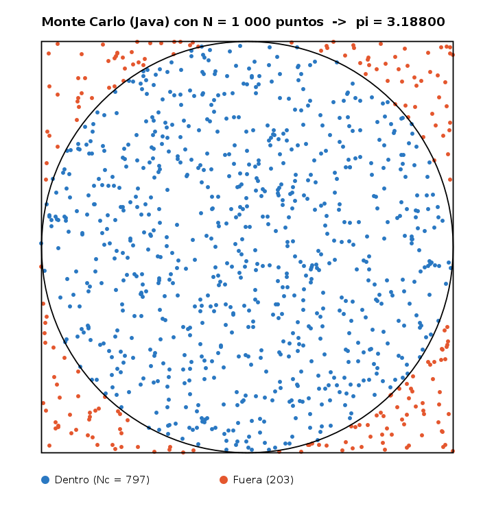
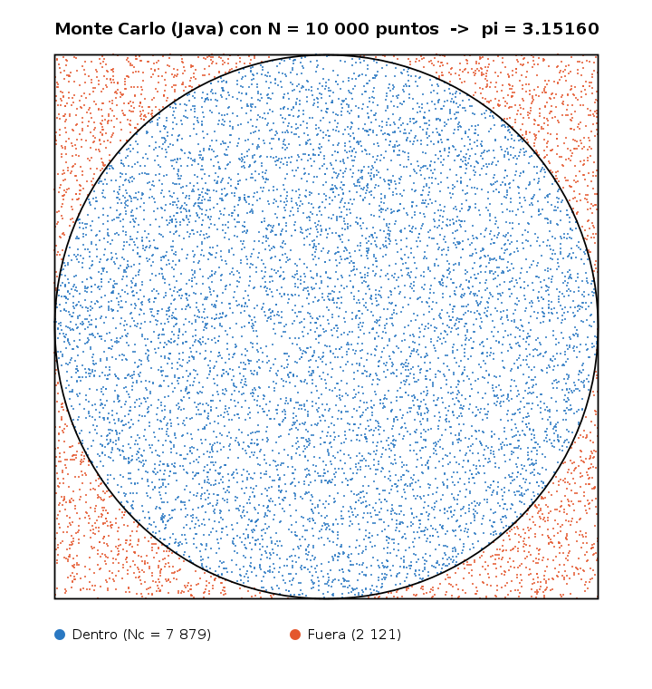
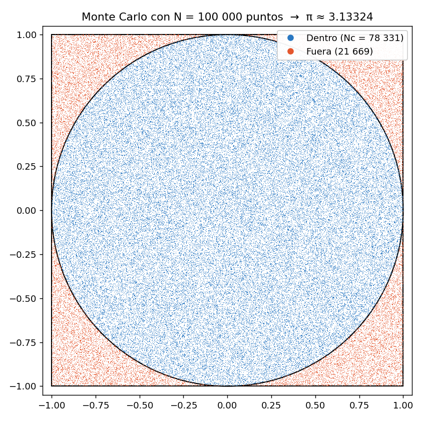
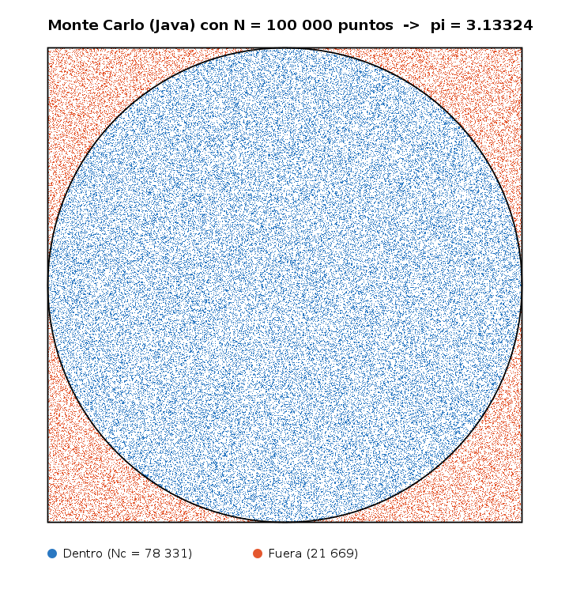
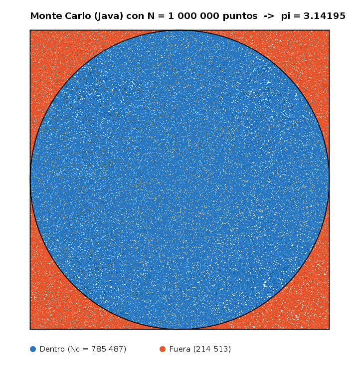
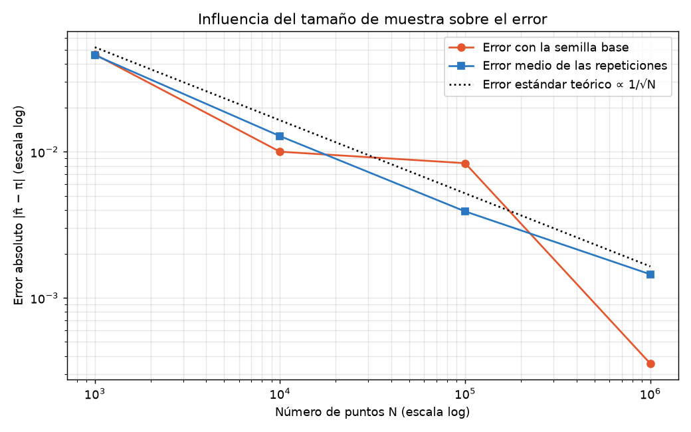

# Estimación de π mediante el método de Monte Carlo en Python y Java

**método de Monte Carlo** para aproximar π lanzando
puntos pseudoaleatorios sobre un cuadrado y contando cuántos caen dentro del círculo inscrito. Los números
se obtienen con un **Generador Congruencial Lineal (LCG)** propio.

```
Cuadrado: [-1, 1] x [-1, 1]  (área 4)        Círculo inscrito: x² + y² <= 1  (área π)

π ≈ 4 · (Nc / N)        Nc = puntos dentro del círculo,  N = puntos generados

LCG:  X(n+1) = (a · X(n) + c) mod m,   U(n) = X(n) / m
Punto i:  x = 2·U(2i−1) − 1,   y = 2·U(2i) − 1
```

La práctica está implementada en **Python y en Java**, con patrón MVC. Ambas usan los mismos parámetros del LCG, por lo que generan la misma
secuencia y la misma estimación de π; lo que cambia es el **tiempo de ejecución**, que se compara.

---

### Qué hace la simulación

1. Muestra los parámetros del LCG y sus primeros 5 números (para comprobar que ambos lenguajes generan lo mismo).
2. Para cada N: genera 2N números, forma N puntos, cuenta Nc, calcula π, el error y mide el tiempo.
3. Repite cada N con 10 semillas distintas (X0 + k·104 729) para medir la variabilidad del error.
4. Si ya existen los resultados del otro lenguaje, arma la **tabla comparativa Python vs Java**.
5. Guarda CSV y gráficas en `Resultados/`, incluida la dispersión de puntos para cada N.

## Tecnologías utilizadas

| Tecnología | Versión | Uso |
|---|---|---|
| Python | 3.10 o superior (probado con 3.13.5) | Primera implementación |
| NumPy | 1.24 o superior (probado con 2.2.4) | Estadísticos de las repeticiones y coordenadas para graficar |
| Matplotlib | 3.6 o superior (probado con 3.10.1) | Gráficas de la versión Python |
| unittest | Biblioteca estándar | Pruebas de la versión Python |
| Java (JDK) | 17 o superior (probado con OpenJDK 21.0.13) | Segunda implementación (usa `record` y `switch` con flechas) |
| Java2D + ImageIO | Incluidos en el JDK | Gráfica de dispersión de la versión Java |


## Instalación de dependencias y configuración del entorno

### Python

1. Verificar la versión (3.10 o superior):

   ```bash
   python3 --version
   ```

2. Instalar NumPy y Matplotlib:

   - **Entorno virtual con pip:**

     ```bash
     cd Simulacion_Monte_Carlo/Python
     python3 -m venv .venv
     source .venv/bin/activate
     pip install -r requirements.txt
     ```

### Java

1. Instalar un JDK 17 o superior (hace falta `javac`, no solo `java`):

   ```bash
   sudo apt install default-jdk
   ```

2. Verificar la instalación:

   ```bash
   javac -version
   ```


## Ejecución

Cada programa compara sus resultados con los del otro lenguaje si ya existen. Orden recomendado:
**Java → Python** (Python arma la tabla comparativa y la gráfica de tiempos). Si después se vuelve a
ejecutar Java, también muestra la comparación desde su lado.

### Versión Java (desde la carpeta `Java`)

```bash
cd Simulacion_Monte_Carlo/Java
```

```bash
javac -encoding UTF-8 -d out Main.java $(find montecarlo -name "*.java")
```

```bash
java -cp out Main
```

### Versión Python (desde la carpeta `Python`)

```bash
cd Simulacion_Monte_Carlo/Python
```

```bash
python3 main.py
```

### Opciones (iguales en ambos lenguajes)

| Opción | Efecto | Ejemplo |
|---|---|---|
| `--tamanios N1 N2 ...` | Valores de N (por defecto 1000 10000 100000 1000000) | `python3 main.py --tamanios 1000 5000` |
| `--semilla X0` | Semilla del LCG (por defecto 12345) | `java -cp out Main --semilla 2026` |
| `--repeticiones R` | Semillas distintas por cada N (por defecto 10; 1 = sin repeticiones) | `python3 main.py --repeticiones 30` |
| `--sin-graficos` | Solo tablas y CSV | `java -cp out Main --sin-graficos` |

Para que la tabla comparativa empareje todos los N, ambos lenguajes deben ejecutarse con las mismas opciones.


## Estructura del proyecto

```
APE7/
├── README.md
├── Informe/                                   Informe de la práctica
└── Simulacion_Monte_Carlo/
    ├── Python/
    │   ├── main.py                            Punto de entrada: lee opciones y conecta las capas
    │   ├── requirements.txt
    │   ├── montecarlo/
    │   │   ├── modelo/                        MODELO: lógica de la simulación
    │   │   │   ├── generador_lcg.py           ParametrosLCG y GeneradorCongruencialLineal
    │   │   │   ├── estimador_pi.py            EstimadorPiMonteCarlo: cuenta Nc y calcula π
    │   │   │   ├── experimento.py             ExperimentoMonteCarlo: tiempos, tamaños y repeticiones
    │   │   │   ├── resultados.py              Estructuras inmutables de resultados
    │   │   │   ├── repositorio_csv.py         Lectura y escritura de CSV
    │   │   │   └── comparador.py              Empareja resultados Python vs Java
    │   │   ├── vista/                         VISTA: presentación
    │   │   │   ├── vista_consola.py           Tablas de texto
    │   │   │   └── vista_graficos.py          Gráficas con Matplotlib
    │   │   └── controlador/                   CONTROLADOR
    │   │       └── controlador_simulacion.py  Configuración y orden de las etapas
    │   ├── tests/test_modelo.py               Pruebas unitarias
    │   └── Resultados/                        CSV y PNG generados por Python
    └── Java/
        ├── Main.java                          Punto de entrada: lee opciones y conecta las capas
        ├── montecarlo/
        │   ├── modelo/                        MODELO
        │   │   ├── ParametrosLCG, GeneradorCongruencialLineal
        │   │   ├── EstimadorPiMonteCarlo, ExperimentoMonteCarlo
        │   │   ├── ResultadoEstimacion, ResumenRepeticiones, MuestraPuntos, FilaComparacion
        │   │   └── RepositorioCSV
        │   ├── vista/                         VISTA
        │   │   ├── VistaConsola               Tablas de texto
        │   │   └── VistaGraficos              Dispersión de puntos con Java2D
        │   └── controlador/                   CONTROLADOR
        │       ├── ConfiguracionSimulacion
        │       └── ControladorSimulacion
        ├── test/PruebasModelo.java            Pruebas sin dependencias externas
        ├── out/                               Clases compiladas (se crea al compilar)
        └── Resultados/                        CSV y PNG generados por Java
```


## Información adicional

### Notas de implementación

- **Misma secuencia en ambos lenguajes:** en Java la aritmética del LCG se hace con `long` (se valida que
  a·(m − 1) + c no desborde), así que es exacta como en Python. U = X/m y las operaciones con los puntos
  son idénticas en doble precisión, por eso π coincide dígito a dígito.
- **Estilo propio de cada lenguaje:** Python usa `dataclass`, NumPy y Matplotlib; Java usa `record`,
  streams, una interfaz funcional para la fuente de números y Java2D.
- **Tiempos:** se mide solo la generación de los 2N números y el conteo. Java hace antes una ejecución sin
  medir para calentar el compilador JIT. Los tiempos cambian en cada ejecución y dependen del equipo.
- **Semillas de las repeticiones:** X0 + k·104 729. No se usan estados consecutivos del LCG como semillas,
  porque cada repetición sería la misma secuencia desplazada una posición y las estimaciones serían casi iguales.


### Capturas

| N = 1 000 (Python) | N = 1 000 (Java) |
|---|---|
|  |  |

| N = 10 000 (Python) | N = 10 000 (Java) |
|---|---|
|  |  |

| N = 100 000 (Python) | N = 100 000 (Java) |
|---|---|
|  |  |

| N = 1 000 000 (Python) | N = 1 000 000 (Java) |
|---|---|
|  |  |

| Convergencia de π | Error frente a N |
|---|---|
|  |  |

| Python vs Java |
|---|
|  |

### Autor

**Anthony Yaguana**
